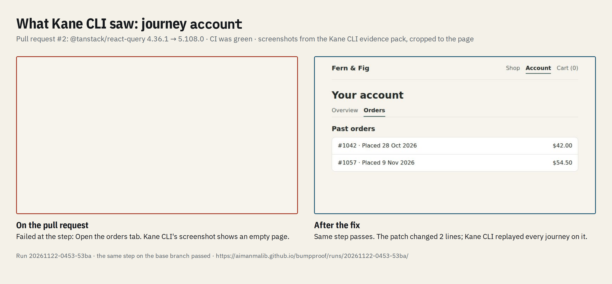
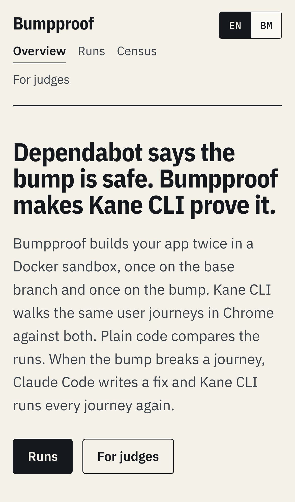
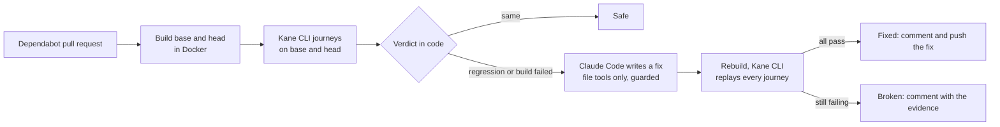

<p align="center"></p>

<h1 align="center">Bumpproof</h1>

<p align="center"><b>Dependabot says the bump is safe. Bumpproof makes Kane CLI prove it in a real browser, and has your coding agent fix what breaks.</b><br>
<a href="https://aimanmalib.github.io/bumpproof/"><b>Report site</b></a> · <a href="#judge-it-in-2-minutes">Judge it in 2 minutes</a> · <a href="#run-it-live">Run it live</a> · <a href="#limitations">Limitations</a> · <a href="#bahasa-melayu">Bahasa Melayu</a><br>
Built in Malaysia by Aiman Malib</p>

<p align="center"><a href="https://github.com/aimanmalib/bumpproof/actions/workflows/ci.yml"></a> <a href="LICENSE"></a></p>

<p align="center"><a href="https://aimanmalib.github.io/bumpproof/runs/20261122-0453-53ba/"></a></p>


- Demo video, 3 minutes, narrated: https://aimanmalib.github.io/bumpproof/media/bumpproof-demo.mp4
- Report site: https://aimanmalib.github.io/bumpproof/
- Census of other people's pull requests: https://aimanmalib.github.io/bumpproof/census.html
- For judges, one page: https://aimanmalib.github.io/bumpproof/judges.html

<p align="center"> </p>

## For judges

The three bars and the four dimensions of the KaneCLI Online Hackathon, and where to check each one.

| | What is asked | Where to check it |
|---|---|---|
| P1 | It works end to end | Pull request [#2](https://github.com/aimanmalib/bumpproof/pull/2): Dependabot opened it, CI was green, Bumpproof commented and pushed a verified fix. [Run page](https://aimanmalib.github.io/bumpproof/runs/20261122-0453-53ba/). |
| P2 | Kane CLI caught or proved something | On #2 Kane CLI found the Orders page blank after the bump, while the base passed. Its bug detection gave the failed step and the reason. The run page shows Kane CLI's screenshot of that step on the base, on the pull request and after the fix. |
| P3 | The agent and Kane CLI talked to each other | Kane CLI's failed step, remark and console errors go into the fixer's prompt ([`src/check-fix.ts#L34`](src/check-fix.ts#L34)). Read the prompt for #2, with Kane CLI's lines marked: [`fixer-prompt.md`](docs/runs/20261122-0453-53ba/fixer-prompt.md). Kane CLI then replays every journey on the patch ([`src/check-fix.ts#L62`](src/check-fix.ts#L62)). |
| K1 | Ships | `npx github:aimanmalib/bumpproof replay docs/runs/20261122-0453-53ba` runs from an empty folder on Node 20 and 22. CI runs it that way, and the full test suite, on every push. |
| K2 | Verified | The verdict is plain code over Kane CLI's results ([`src/compare.ts`](src/compare.ts)), with the base branch as the reference. The census also runs base against base, as a control. |
| K3 | Closed loop | One command goes from the pull request to a fix that Kane CLI has passed. The fix is pushed only after that ([`src/pr.ts`](src/pr.ts)). |
| K4 | Craft | Docker sandbox, file-only fixer with guards ([`test/guards.test.ts`](test/guards.test.ts)), English and Malay output, every number below counted from JSON. |

## Results

<!-- bumpproof:numbers:start -->

Each row is one `bumpproof pr … --fix --publish --comment` run on a pull request Dependabot opened on this repository. On #1 and #2 the verified fix was also pushed (`--push-fix`). #3 was left as Dependabot opened it, so the break can still be reproduced. Nothing was merged.

| Pull request | Change | CI on GitHub | Bumpproof | Kane CLI credits | Fixer (Claude API) | Time |
|---|---|---|---|---|---|---|
| [#4](https://github.com/aimanmalib/bumpproof/pull/4) | clsx 1.2.1 → 2.1.1 | green | [Safe](https://aimanmalib.github.io/bumpproof/runs/20261122-0437-f93b/): 3 of 3 journeys same as base | 6.4 | — | 15 min 06 s |
| [#3](https://github.com/aimanmalib/bumpproof/pull/3) | react-router-dom 6.30.1 → 7.18.6 | green | [Fixed](https://aimanmalib.github.io/bumpproof/runs/20261122-1830-1146/): 1 of 3 journeys failed, 8-line fix, 3 of 3 pass | 43.7 | $0.15 | 12 min 51 s |
| [#2](https://github.com/aimanmalib/bumpproof/pull/2) | @tanstack/react-query 4.36.1 → 5.108.0 | green | [Fixed](https://aimanmalib.github.io/bumpproof/runs/20261122-0453-53ba/): 3 of 3 journeys failed, 2-line fix, 3 of 3 pass | 102 | $0.18 | 22 min 34 s |
| [#1](https://github.com/aimanmalib/bumpproof/pull/1) | date-fns 2.30.0 → 4.4.0 | red | [Fixed](https://aimanmalib.github.io/bumpproof/runs/20261122-0516-0348/): build failed, 6-line fix, 3 of 3 pass | 3.8 | $0.16 | 15 min 50 s |

The other numbers, counted the same way as on the report site:

- **H2 Census of third-party pull requests: 8 of 14.** 241 pull requests checked against the rules, 20 eligible, 14 run. 8 could be run in the sandbox. Source: `census/results.json · census/candidates.json`.
- **H3 CI green, app broken: 0.** Census pull requests where CI was green or absent but Kane CLI found a break: 0 of 8. Source: `census/results.json`.
- **H4 False alarms in the control run: 0 of 8.** Base replayed against base: 8 same, 0 false alarm, 0 inconclusive. Source: `census/results.json`.
- **H5 Fix loop time and credits: 6 min 16 s.** Median time from the failed check to Kane CLI passing on the patch, over 4 fixes. Median 25 Kane CLI credits per pull request (4 pull requests). In the census, authoring a journey cost 33.4 credits on average and replaying a recording cost 8.1. That is 4.1 to 1. Source: `docs/runs/*/run.json · census/kredit.json`.
- **H6 Breaks fixed: 4 of 5.** Among runs with the fixer switched on: 4 of 4 on the demo app, 0 of 1 in the census. 6 attempts in all. Source: `docs/runs/*/run.json · census/runs/*/run.json`.

<!-- bumpproof:numbers:end -->

## Judge it in 2 minutes

No keys and no credits. The replay needs the network once, to download the package.

1. Open the [report site](https://aimanmalib.github.io/bumpproof/) and a run page.
2. Replay a recorded run in your terminal:

   ```sh
   npx github:aimanmalib/bumpproof replay docs/runs/20261122-0453-53ba
   ```

3. Check the numbers against the files they come from: [`docs/runs/*/run.json`](docs/runs) and
   [`census/results.json`](census/results.json).

## Reproduce a catch live (no Anthropic key)

Pull request [#3](https://github.com/aimanmalib/bumpproof/pull/3) is left as Dependabot opened it. Its verified fix is on the
[run page](https://aimanmalib.github.io/bumpproof/runs/20261122-1830-1146/), not on the branch. You can make Kane CLI catch
the break again with your own account. It needs Node 20 or later, Docker and a Kane CLI login. Without `--fix` nothing is
patched, so no Anthropic key is needed.

```sh
npm install -g --install-links github:aimanmalib/bumpproof
git clone https://github.com/aimanmalib/bumpproof
cd bumpproof
bumpproof check --base 8ff77fe --head 05f11be --dir examples/shop
```

`05f11be` is Dependabot's commit on #3. `8ff77fe` is the commit it branched from, plus the three journeys; the shop code is
the same. Run from a fresh clone on 22 November: the base passed, and on the bump `account` failed at "Use the tabs again".
Verdict Broken, 8 min 43 s, 25.0 Kane CLI credits. It was the third time that step failed on #3.

#1 and #2 now carry their fixes. Their original Dependabot commits replay the same way, also measured from a fresh clone:

- #1: `bumpproof check --base f68676c --head 8ea9eb6 --dir examples/shop`. The build fails
  (`Missing "./esm/addDays" specifier`). 2 min 59 s, 1.6 credits.
- #2: `bumpproof check --base 8ff77fe --head 5243b1d --dir examples/shop`. All three journeys fail. 11 min 06 s, 101.7 credits.

## Run it live

Needs Node 20 or later, Docker, `gh` logged in, Kane CLI logged in, and Claude Code for `--fix`.

```sh
npm install -g --install-links github:aimanmalib/bumpproof
bumpproof doctor
bumpproof init                                  # writes .bumpproof/config.json and draft journeys
bumpproof pr <owner>/<repo>#<number> --fix      # check one pull request, fix what breaks
```

`init` finds the package manager, the build and serve commands, and the routes in your source. It writes them to
`.bumpproof/config.json` and drafts two or three journeys in `.bumpproof/journeys/`. It does not overwrite files that
are already there. This is the output on a copy of `examples/shop` with its `.bumpproof/` folder removed:

```text
$ bumpproof init
Found an app in . (package manager: npm).
Install: npm ci --ignore-scripts --include=dev --no-audit --no-fund
Build:   npm run build
Serve:   npx --no-install vite preview --host 0.0.0.0 --port {port} --strictPort
Port:    4173
Routes in the source: /, /cart, /shop, /account, /checkout
Wrote .bumpproof/config.json
Wrote .bumpproof/journeys/home_test.md
Wrote .bumpproof/journeys/nav_test.md
Wrote .bumpproof/journeys/cart_test.md
These journeys are drafts. Read each one and change the steps to what your app must do.
Then run: bumpproof check --base <ref> --head <ref>
```

Read the drafts and change the steps to what your app must do. `--dir <folder>` points it at an app inside a larger
repository. Next.js routes are read from `app/` and `pages/`, also under `src/`.

Each check builds two copies of the app in Docker. Bumpproof refuses to start with less than 25 GB free disk.
The limit is `sandbox.min_free_gb` in the config, or `--min-free-gb <n>` for one run.

`--comment` posts the result on the pull request. `--push-fix` pushes the verified fix to the pull request branch.
Both work only on repositories you list in `pr.write_repos`. Bumpproof never merges.

Kane CLI reads `KANE_USERNAME` and `KANE_ACCESS_KEY` from the environment, or uses its own login.
The fixer runs `claude -p`; set `ANTHROPIC_API_KEY` or log in to Claude Code first.
Every setting is in [`config/defaults.json`](config/defaults.json). A `.bumpproof/config.json` in your app overrides it.

## How it works

`bumpproof pr <owner>/<repo>#<number> --fix` takes one dependency pull request and:

1. Reads the pull request with `gh` and works out which packages changed from `package.json`, not from the title.
2. Merges the pull request onto the current tip of its base branch, in a fresh clone.
3. Builds and serves the base, then the merge, each in its own Docker container.
4. Runs the app's Kane CLI journeys (`*_test.md`) in Chrome against both. The base is the reference.
5. Decides the verdict in code: safe, fixed, broken or could not run.
6. On a regression or a failed build, Claude Code (headless) patches a copy, using Kane CLI's failure and the release notes.
   The sandbox rebuilds the copy and Kane CLI replays every journey. Only if all of them pass again is it "fixed".



## Where Kane CLI is used

Kane CLI has three jobs in every run. The verdict is our code reading its results.

| Job | What Kane CLI does | Where |
|---|---|---|
| Reference on the base | Replays each journey on the base branch first. A journey that fails there is left out of the verdict. | [`src/check-journeys.ts#L65`](src/check-journeys.ts#L65), [`src/compare.ts#L61`](src/compare.ts#L61) |
| Detector on the pull request | Replays the same journeys on the head. Passed on the base and failed on the head is a regression. Its failed step, remark and result code go into the comment. | [`src/compare.ts#L43`](src/compare.ts#L43), [`src/report/markdown.ts#L44`](src/report/markdown.ts#L44) |
| Proof after the fix | Its failed step, remark and console errors go into the fixer's prompt. Then it replays every journey on the patched app. The fix counts only when they all pass. | [`src/check-fix.ts#L34`](src/check-fix.ts#L34), [`src/check-fix.ts#L62`](src/check-fix.ts#L62) |

How Bumpproof drives it:

| What | Where |
|---|---|
| `kane-cli testmd run <journey> --agent --headless --bug-detection continue` | [`src/kane.ts#L139`](src/kane.ts#L139), flags in [`config/defaults.json#L85`](config/defaults.json#L85) |
| One journey run, refused when the credit budget is spent | [`src/journeys.ts#L92`](src/journeys.ts#L92), budget [`src/kane.ts#L186`](src/kane.ts#L186) |
| Reading the JSON event stream: steps, healing, `run_end`, `test_md_done` | [`src/kane.ts#L57`](src/kane.ts#L57) |
| `credits_consumed` per run, added to a ledger | [`src/kane.ts#L106`](src/kane.ts#L106), ledger [`census/kredit.json`](census/kredit.json) |
| Evidence pack (`.evidence` zip): console and network errors, scrubbed before publishing | [`src/evidence.ts#L27`](src/evidence.ts#L27), [`src/evidence.ts#L117`](src/evidence.ts#L117) |
| Journeys authored once on a census repository's base, then replayed | [`src/census-run.ts#L86`](src/census-run.ts#L86) |

What the agent was told: every fixed run has a `fixer-prompt.md` next to its `run.json`, linked from the run page as
"What the agent was told". Lines that carry Kane CLI's words are marked `K`. Runs from 22 Nov 2026 have a copy rebuilt
from the recorded inputs with the same code ([`scripts/add-prompt.ts`](scripts/add-prompt.ts)), and the file says so.
New runs save the prompt as sent.

Plainly: the loop starts on a developer's machine (`bumpproof pr … --fix`), not in CI. In every fixed run so far, the
first patch passed Kane CLI's replay. No run yet has had a first attempt that Kane CLI turned down. In one census run
the guards refused both attempts because no file changed.

## Bumpproof and kane-cli-pr

Kane CLI has an official GitHub Action, `kane-cli-pr`. It runs when a person comments `@kane-cli` on a pull request, against
tests linked in Test Manager. Bumpproof starts from the bot's pull request itself, uses the base branch as the reference so no
tests need to be set up first, and has a coding agent write the migration. They work well side by side.

The GitHub Action in this repository ([`action.yml`](action.yml)) only checks that the head builds and starts, and comments.
It needs no LLM key. Browser journeys and fixes run from the CLI.

## Safety

- The app under test runs in Docker with `--cap-drop ALL`, `no-new-privileges`, CPU, memory and process limits, the
  port bound to 127.0.0.1, and install scripts turned off ([`src/sandbox.ts`](src/sandbox.ts)).
- The fixer gets file tools only (Read, Edit, Write, Glob, Grep). No shell, no web, no MCP. Guards reject patches that touch
  tests, journeys or CI files, change versions in `package.json`, add `child_process` or `eval`, or are too large
  ([`src/guards.ts`](src/guards.ts)).
- Release notes reach the fixer marked as untrusted input ([`prompts/fixer.md`](prompts/fixer.md)).
- `--comment` and `--push-fix` work only on repositories listed in `pr.write_repos`. A fix is pushed only when each
  file it changes is the same on the branch as on the commit it was verified on. No force push.
- The census only reads other people's repositories. No comments, issues or pull requests were opened on them. Patches stay
  in this repository's report.
- Published run records pass a scan for emails, tokens, cookies and private URLs before they are written.

See [SECURITY.md](SECURITY.md) to report a problem.

## Limitations

- One demo app with three journeys. The census is small, and most apps found could not run in the sandbox.
- A failing journey costs many times the credits of a passing one.
  See the head runs on the [#2 run page](https://aimanmalib.github.io/bumpproof/runs/20261122-0453-53ba/).
- Kane CLI heals small UI changes. A journey that passes after healing is reported as "UI moved, still works", not
  silently as the same.
- Apps that need a database, an API server or secrets to start are not supported. The census marks them as could not run.
- npm only. One app directory per run.

## How AI is used

The code in this repository was written with Claude Code (Opus 5.5), directed by the author.
Claude Code in headless mode is also the fixer inside the product loop. Fix commits pushed to pull requests say so in their message.
Kane CLI, which drives Chrome, is an AI agent too.

AI disclosure: code and docs written with an AI coding agent; the fixer is an AI agent; the demo video narration is the
author's voice cloned with ElevenLabs.

The full declaration is in [AI_USAGE.md](AI_USAGE.md).

## Built during the KaneCLI Online Hackathon

Built during the KaneCLI Online Hackathon (12–26 Nov 2026). First commit:
[`813035c`](https://github.com/aimanmalib/bumpproof/commit/813035c), 21 Nov 2026.
Changes are listed in [CHANGELOG.md](CHANGELOG.md). Contributions: [CONTRIBUTING.md](CONTRIBUTING.md).

## Bahasa Melayu

Bumpproof menyemak PR naik taraf pakej (Dependabot atau Renovate) dalam pelayar sebenar. Ia membina aplikasi dua kali dalam
Docker, sekali pada cawangan asas dan sekali pada PR. Kane CLI menjalankan perjalanan pengguna yang sama dalam Chrome pada
kedua-duanya. Bila PR merosakkan perjalanan, Claude Code menulis pembaikan dan Kane CLI menjalankan semula semua perjalanan.
Ia tidak pernah menggabung PR.

Laman laporan dalam Bahasa Melayu: https://aimanmalib.github.io/bumpproof/?lang=ms

## License

Apache-2.0. See [LICENSE](LICENSE) and [NOTICE](NOTICE).
